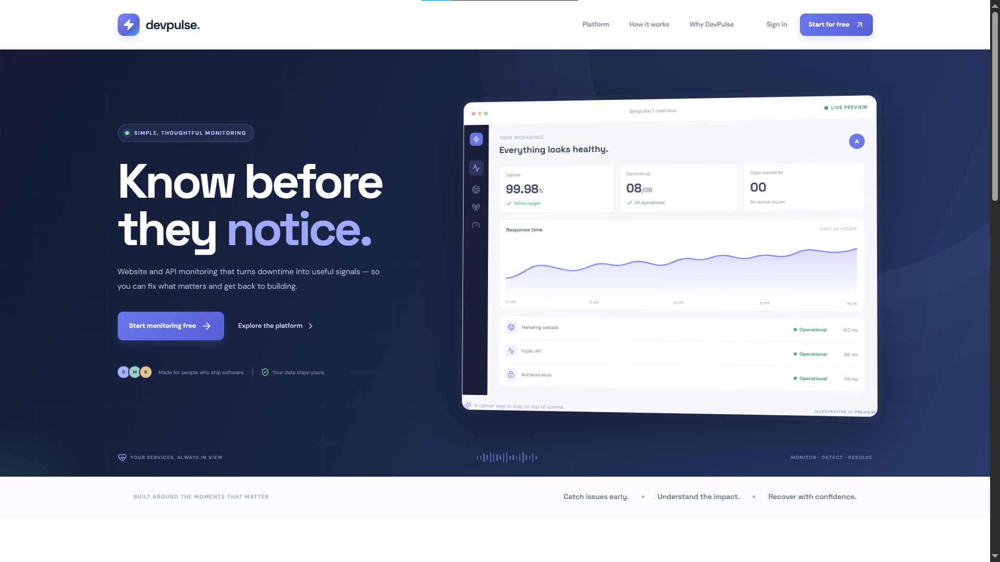
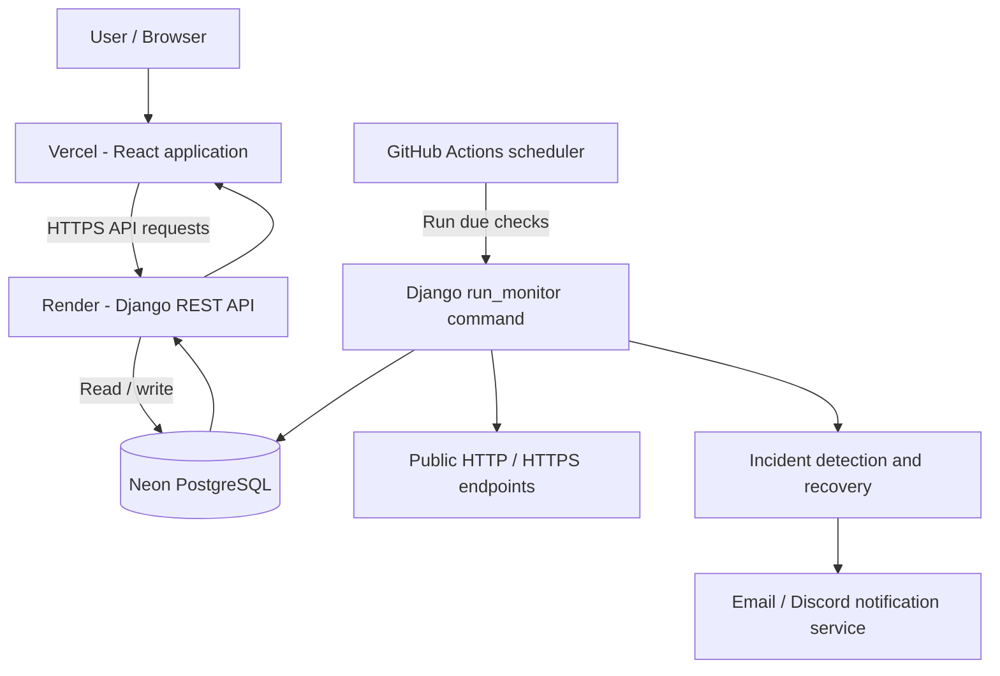

<div align="center">

# ⚡ DevPulse

### Monitor. Detect. Notify. Resolve.

**A website uptime monitoring and incident management platform built for developers.**

Track websites and APIs, detect service failures, investigate incidents, and keep users informed through a clean monitoring workspace.

<br/>

[](https://react.dev/)
[](https://www.djangoproject.com/)
[](https://www.django-rest-framework.org/)
[](https://www.postgresql.org/)
[](https://vite.dev/)

<br/>

[Live Application](https://devpulse-seven-indol.vercel.app/) · [API Documentation](https://devpulse-api-n21z.onrender.com) · [Report an Issue](../../issues)

</div>

---

## ✨ About DevPulse

DevPulse is a full-stack SaaS-style application for monitoring the availability and performance of websites and HTTP APIs. It gives developers one place to organize services, run health checks, review response times, track incidents, configure alerts, and publish a public status page.

Instead of manually opening every URL to see whether it is working, DevPulse periodically checks configured endpoints and records the results. When a service repeatedly fails its health check, DevPulse opens an incident. When the service recovers, the incident is resolved automatically after the configured recovery threshold is met.

**Built with:** React, Django REST Framework, PostgreSQL, Python Requests, and scheduled Django management commands.

## 🚀 What you can do with DevPulse

| Capability                  | What it does                                                                          |
| --------------------------- | ------------------------------------------------------------------------------------- |
| **Project organization**    | Group related websites and APIs into projects.                                        |
| **Website & API monitors**  | Register public HTTP/HTTPS endpoints and define expected responses.                   |
| **Scheduled health checks** | Check due monitors at configured intervals and record each result.                    |
| **Response-time tracking**  | Measure the elapsed time for each health check.                                       |
| **Incident detection**      | Open incidents after consecutive failed checks to reduce false alarms.                |
| **Automatic recovery**      | Resolve active incidents after consecutive successful checks.                         |
| **Incident investigation**  | Acknowledge incidents and add investigation notes to the timeline.                    |
| **Notifications**           | Configure project-level email and Discord webhook channels and inspect delivery logs. |
| **Analytics**               | Review monitor health, check counts, estimated uptime, and average response time.     |
| **Public status pages**     | Publish a shareable page showing current service states and active incidents.         |
| **JWT authentication**      | Register, sign in, refresh access tokens, and manage your profile.                    |

## 🖥️ Application areas

- **Landing page** — product overview and entry points for sign-in and registration.
- **Dashboard** — monitor summary, service health and active incident overview.
- **Projects** — create and manage groups of monitored services.
- **Monitors** — add, edit, pause, resume, manually check and inspect monitored endpoints.
- **Monitor details** — review recent health-check history and monitor analytics.
- **Incidents** — review incident state, acknowledge incidents and record investigation notes.
- **Notifications** — configure email and Discord destinations and review notification logs.
- **Analytics** — view overview and per-monitor performance statistics.
- **Status pages** — manage public status pages and view public service status.
- **Settings** — manage the signed-in user's profile.

<!-- > **Screenshots:** Add screenshots of your deployed application to `docs/screenshots/` and link them here. Suggested captures: `landing.png`, `dashboard.png`, `monitors.png`, `incident-detail.png`, and `status-page.png`. -->

<p align="center">
  
</p>
<p align="center">
  
</p>
<p align="center">
  
</p>
<p align="center">
  
</p>

## 🧰 Tech stack

### Frontend

| Technology     | Usage                                   |
| -------------- | --------------------------------------- |
| React 18       | Component-based user interface          |
| Vite 6         | Development server and production build |
| Tailwind CSS 3 | Utility-first styling                   |
| React Router 6 | Client-side routing                     |
| Axios          | HTTP requests to the Django API         |
| Recharts       | Analytics charts                        |
| Lucide React   | Interface icons                         |
| date-fns       | Date formatting and presentation        |

### Backend

| Technology                 | Usage                                     |
| -------------------------- | ----------------------------------------- |
| Python 3.14                | Backend language                          |
| Django 6.1                 | Application framework                     |
| Django REST Framework 3.18 | REST API layer                            |
| Simple JWT                 | Access and refresh token authentication   |
| PostgreSQL                 | Persistent relational database            |
| psycopg                    | PostgreSQL driver                         |
| Requests                   | HTTP/HTTPS health checks                  |
| drf-spectacular            | OpenAPI schema and Swagger UI             |
| django-cors-headers        | Cross-origin API access from the frontend |
| Gunicorn                   | Production WSGI server                    |
| WhiteNoise                 | Django static-file serving                |

### Hosting and automation

| Service        | Responsibility                                                    |
| -------------- | ----------------------------------------------------------------- |
| Vercel         | React frontend hosting                                            |
| Render         | Django API hosting                                                |
| Neon           | Managed PostgreSQL database                                       |
| GitHub Actions | Scheduled monitoring command and optional admin creation workflow |

**No Redis or Celery is required** in the current implementation. Periodic checks are performed by the Django `run_monitor` management command, invoked by a scheduler.

## 🏗️ System architecture



### Monitoring lifecycle

1. A user creates a project and adds a monitor with a public URL, check interval, timeout and expected HTTP status code.
2. The monitor configuration is stored in PostgreSQL with its next scheduled check time.
3. The scheduler invokes `python manage.py run_monitor`.
4. The command claims due monitors, executes HTTP checks, measures response time and records each result.
5. Consecutive failures can change a monitor to `DOWN` and create an incident.
6. Consecutive successful checks can change the monitor back to `UP` and resolve its active incident.
7. Incident events are recorded and enabled notification channels are notified.
8. The React dashboard reads the updated monitor, incident and analytics data through the REST API.

## 🗂️ Repository structure

```text
DevPulse/
│
├── frontend/                         # React + Vite application
│   ├── public/                       # Static assets and favicon
│   └── src/
│       ├── api/                      # API client and endpoint helpers
│       ├── components/               # Reusable UI components
│       ├── context/                  # Authentication and toast contexts
│       ├── layouts/                  # Application shell and navigation
│       ├── pages/                    # Landing, dashboard and product pages
│       ├── utils/                    # Formatting and helper functions
│       ├── App.jsx                   # Client-side routes
│       └── main.jsx                  # React entry point
│
├── backend/                          # Django REST API
│   ├── config/                       # Django settings and root URLs
│   ├── apps/
│   │   ├── accounts/                 # Custom user and authentication APIs
│   │   ├── projects/                 # Projects and status page management
│   │   ├── monitors/                 # Monitors and health-check history
│   │   ├── incidents/                # Incident lifecycle and event timeline
│   │   ├── notifications/             # Notification channels and logs
│   │   ├── analytics/                 # Monitoring statistics
│   │   └── status_pages/              # Public status endpoint
│   ├── core/                         # Shared validation and security helpers
│   ├── postman/                      # Importable Postman collection
│   ├── manage.py
│   └── requirements.txt
│
├── .github/
│   └── workflows/                    # Scheduled monitoring / admin workflow
│
├── docs/                             # Optional project documentation/screenshots
├── .gitignore
└── README.md
```

## ⚙️ Run locally

### Prerequisites

Install the following before starting:

- Python **3.14**
- Node.js **20.19+** or **22.12+**
- PostgreSQL **15+**
- Git
- Postman (recommended for API testing)

### 1. Clone the repository

```bash
git clone https://github.com/YOUR_USERNAME/DevPulse.git
cd DevPulse
```

### 2. Set up the Django backend

Open a terminal in the project root:

```bash
cd backend
```

Create and activate a virtual environment.

**Windows PowerShell**

```powershell
py -3.14 -m venv .venv
.venv\Scripts\Activate.ps1
```

**Linux / macOS**

```bash
python3.14 -m venv .venv
source .venv/bin/activate
```

Install backend dependencies:

```bash
python -m pip install --upgrade pip
pip install -r requirements.txt
```

Create a PostgreSQL database named `devpulse`:

```sql
CREATE DATABASE devpulse;
```

Create `backend/.env` from `backend/.env.example` and update the values:

```env
SECRET_KEY=replace-with-a-long-random-secret
DEBUG=True
ALLOWED_HOSTS=127.0.0.1,localhost
CORS_ALLOWED_ORIGINS=http://localhost:5173

# Local PostgreSQL connection
DB_ENGINE=postgresql
DB_NAME=devpulse
DB_USER=postgres
DB_PASSWORD=your_local_postgres_password
DB_HOST=127.0.0.1
DB_PORT=5432

# Optional email configuration
EMAIL_HOST=smtp.gmail.com
EMAIL_PORT=587
EMAIL_USE_TLS=True
EMAIL_HOST_USER=
EMAIL_HOST_PASSWORD=
DEFAULT_FROM_EMAIL=DevPulse <no-reply@example.com>

# Monitoring rules
MONITOR_BATCH_SIZE=100
MONITOR_FAILURE_THRESHOLD=2
MONITOR_RECOVERY_THRESHOLD=2
```

Generate the initial migrations for the custom user and application models, if they are not already present in the repository:

```bash
python manage.py makemigrations accounts projects monitors incidents notifications
python manage.py migrate
```

> Commit migration files to Git. The custom `accounts.User` model must be included in the initial migration for a fresh database. Do not regenerate or replace existing production migrations casually.

Create an administrator account:

```bash
python manage.py createsuperuser
```

Run Django checks and start the API:

```bash
python manage.py check
python manage.py runserver
```

Backend URLs:

- Django API: `http://127.0.0.1:8000/`
- Django Admin: `http://127.0.0.1:8000/admin/`
- OpenAPI schema: `http://127.0.0.1:8000/api/schema/`
- Swagger UI: `http://127.0.0.1:8000/api/docs/`

### 3. Set up the React frontend

Open a second terminal from the repository root:

```bash
cd frontend
npm install
```

Create `frontend/.env` from `frontend/.env.example`:

```env
VITE_API_BASE_URL=http://127.0.0.1:8000/api
```

Start the Vite development server:

```bash
npm run dev
```

Open `http://localhost:5173`.

To create and preview a production build locally:

```bash
npm run build
npm run preview
```

### 4. Run scheduled monitoring locally

The API server does not automatically run scheduled checks. In a separate backend terminal, execute:

```bash
python manage.py run_monitor
```

For continuous local development, schedule this command with Windows Task Scheduler or a Linux/macOS cron entry. The command processes monitors whose `next_check_at` time is due.

## 🔌 API overview

All API routes are under `/api/`. Protected endpoints require a JWT access token in the request header:

```http
Authorization: Bearer <access-token>
```

### Authentication

| Method  | Endpoint                   | Description                          | Auth                      |
| ------- | -------------------------- | ------------------------------------ | ------------------------- |
| `POST`  | `/api/auth/register/`      | Register a user                      | Public                    |
| `POST`  | `/api/auth/token/`         | Obtain JWT access and refresh tokens | Public                    |
| `POST`  | `/api/auth/token/refresh/` | Refresh an access token              | Public with refresh token |
| `GET`   | `/api/auth/me/`            | Retrieve current user profile        | Required                  |
| `PATCH` | `/api/auth/me/`            | Update current user profile          | Required                  |

The token endpoint expects a `username` and `password`.

### Projects and monitors

| Method                          | Endpoint                        | Description                                     |
| ------------------------------- | ------------------------------- | ----------------------------------------------- |
| `GET`, `POST`                   | `/api/projects/`                | List or create projects                         |
| `GET`, `PUT`, `PATCH`, `DELETE` | `/api/projects/{id}/`           | Retrieve or modify a project                    |
| `GET`, `POST`                   | `/api/monitors/`                | List or create monitors                         |
| `GET`, `PUT`, `PATCH`, `DELETE` | `/api/monitors/{id}/`           | Retrieve or modify a monitor                    |
| `GET`                           | `/api/monitors/{id}/checks/`    | Retrieve the latest recorded checks (up to 100) |
| `POST`                          | `/api/monitors/{id}/check-now/` | Execute an immediate health check               |

Example monitor payload:

```json
{
  "project": 1,
  "name": "Production API",
  "url": "https://example.com/health",
  "check_interval": 300,
  "timeout": 10,
  "expected_status_code": 200,
  "expected_keyword": "ok",
  "is_active": true
}
```

Supported monitor intervals are 60, 300, 600, 1800 and 3600 seconds. The deployed GitHub Actions scheduler runs every five minutes, so the free-tier hosted setup should use intervals of at least 300 seconds.

### Incidents

| Method | Endpoint                           | Description                                                                             |
| ------ | ---------------------------------- | --------------------------------------------------------------------------------------- |
| `GET`  | `/api/incidents/`                  | List the current user's incidents; accepts `?status=OPEN`, `ACKNOWLEDGED` or `RESOLVED` |
| `GET`  | `/api/incidents/{id}/`             | Retrieve incident details and events                                                    |
| `POST` | `/api/incidents/{id}/acknowledge/` | Acknowledge an active incident                                                          |
| `POST` | `/api/incidents/{id}/notes/`       | Add an investigation note                                                               |

Example note payload:

```json
{
  "message": "Investigating the upstream application server."
}
```

Incidents are opened after the configured number of consecutive failed checks and are automatically resolved after the configured number of consecutive successful checks. The API intentionally does not offer a manual resolve action that could mark a still-failing monitor as recovered.

### Notifications

| Method                          | Endpoint                           | Description                                  |
| ------------------------------- | ---------------------------------- | -------------------------------------------- |
| `GET`, `POST`                   | `/api/notification-channels/`      | List or create project notification channels |
| `GET`, `PUT`, `PATCH`, `DELETE` | `/api/notification-channels/{id}/` | Retrieve or modify a channel                 |
| `GET`                           | `/api/notification-logs/`          | Review notification delivery logs            |

Channel types currently supported: `EMAIL` and `DISCORD`.

Example Discord channel payload:

```json
{
  "project": 1,
  "channel_type": "DISCORD",
  "target": "https://discord.com/api/webhooks/WEBHOOK_ID/WEBHOOK_TOKEN",
  "is_active": true
}
```

### Analytics and public status pages

| Method                          | Endpoint                                  | Description                                                        |
| ------------------------------- | ----------------------------------------- | ------------------------------------------------------------------ |
| `GET`                           | `/api/analytics/overview/`                | Monitor counts and active incident count; optional `?project_id=1` |
| `GET`                           | `/api/analytics/monitors/{id}/?period=7d` | Per-monitor statistics for `24h`, `7d` or `30d`                    |
| `GET`, `POST`                   | `/api/status-pages/`                      | List or create the signed-in owner's status pages                  |
| `GET`, `PUT`, `PATCH`, `DELETE` | `/api/status-pages/{id}/`                 | Retrieve or modify a status page                                   |
| `GET`                           | `/api/public/status/{slug}/`              | Public status data; no JWT required                                |

Example status page payload:

```json
{
  "project": 1,
  "title": "Acme Service Status",
  "slug": "acme-status",
  "is_public": true
}
```

## 🧪 Test with Postman

An importable Postman collection is available at:

```text
backend/postman/DevPulse.postman_collection.json
```

1. Open Postman and import the collection.
2. Set its `base_url` variable to `http://127.0.0.1:8000/api` for local development, or your deployed Render API base URL.
3. Register a user and obtain a token.
4. Authenticate protected requests with `Bearer <access-token>`.
5. Create a project, add a monitor, and run a manual health check.
6. Inspect check history, incidents, analytics and notification logs.

Useful commands:

```bash
# Django system checks
python manage.py check

# Run tests
python manage.py test apps.monitors apps.incidents

# Process monitors that are due
python manage.py run_monitor
```

## 🌍 Deployment

The project is deployed as a split application:

| Part      | Platform       | Configuration                                                      |
| --------- | -------------- | ------------------------------------------------------------------ |
| Frontend  | Vercel         | Root: `frontend`; build: `npm run build`; output: `dist`           |
| Backend   | Render         | Root: `backend`; Gunicorn starts `config.wsgi:application`         |
| Database  | Neon           | PostgreSQL connection supplied through `DATABASE_URL`              |
| Scheduler | GitHub Actions | Runs `python manage.py run_monitor --limit 100` every five minutes |

### Required production environment variables

**Render backend**

| Variable                     | Purpose                                                  |
| ---------------------------- | -------------------------------------------------------- |
| `SECRET_KEY`                 | Strong, unique Django secret key                         |
| `DEBUG`                      | Set to `False`                                           |
| `ALLOWED_HOSTS`              | Render backend hostname                                  |
| `DATABASE_URL`               | Neon PostgreSQL direct connection URL with SSL required  |
| `CORS_ALLOWED_ORIGINS`       | Exact Vercel frontend origin                             |
| `CSRF_TRUSTED_ORIGINS`       | Trusted HTTPS frontend/backend origins                   |
| `SECURE_SSL_REDIRECT`        | Set to `True` behind Render HTTPS proxy                  |
| `MONITOR_BATCH_SIZE`         | Maximum due monitors processed in one command invocation |
| `MONITOR_FAILURE_THRESHOLD`  | Consecutive failures before opening an incident          |
| `MONITOR_RECOVERY_THRESHOLD` | Consecutive successes before resolving an incident       |

**Vercel frontend**

| Variable            | Purpose                                  |
| ------------------- | ---------------------------------------- |
| `VITE_API_BASE_URL` | Public Render API root, including `/api` |

**GitHub Actions repository secrets**

| Secret                      | Purpose                                                 |
| --------------------------- | ------------------------------------------------------- |
| `DATABASE_URL`              | Neon database connection used by the scheduled workflow |
| `DJANGO_SECRET_KEY`         | Django secret key used by the workflow                  |
| `DJANGO_SUPERUSER_PASSWORD` | Optional secret for the manual admin-creation workflow  |

Never commit `.env` files, database URLs, Django secret keys, email credentials or Discord webhook URLs.

## 🔐 Security notes

- JWT authentication protects user-specific API endpoints.
- Project, monitor, incident and notification querysets are scoped to the authenticated owner.
- Monitor URL validation allows HTTP/HTTPS URLs and rejects local/private network destinations as a baseline SSRF defense.
- Monitor requests do not follow redirects, reducing redirect-based access to restricted targets.
- Production settings should use `DEBUG=False`, a strong secret key, HTTPS, strict `ALLOWED_HOSTS`, and exact CORS origins.
- Do not expose database credentials, email passwords, or Discord webhook tokens in frontend code or public repositories.
- The current frontend stores JWT tokens in `sessionStorage`. A hardened production authentication design could use secure HttpOnly cookies with corresponding backend changes.
- URL validation alone is not a complete SSRF boundary. Production infrastructure should additionally enforce outbound network rules blocking private, loopback, link-local and cloud metadata ranges.

## 📊 Measurement and implementation notes

A few details matter when interpreting the dashboard:

- **Uptime is a sample-based estimate**, calculated as successful recorded checks divided by all recorded checks during the selected period. It is not a measurement of every second of the period.
- **Monitor check history** currently returns up to the latest 100 checks per monitor.
- **Public status pages** currently expose current service states and active incidents. They do not expose historical uptime charts.
- **Projects are single-owner** in the current version. Team invitations, shared workspaces and role-based team access are not implemented.
- **Notification delivery is synchronous** in the current backend. A slow provider can delay incident processing; a task queue is a possible future improvement.
- **Email on Render Free:** the current email implementation uses SMTP. Render Free blocks outbound SMTP ports 25, 465 and 587, so email delivery requires a supported HTTPS email-provider integration or a hosting plan that permits SMTP. Discord webhooks use HTTPS.
- **Free-tier scheduling:** GitHub Actions schedules can be delayed and are not an exact-time guarantee. This setup is intended for a portfolio/demo deployment, not an uptime SLA or critical production monitoring service.
- **Free-tier availability:** Render Free web services can spin down after inactivity, and Neon Free can scale compute to zero. The first request after idle time may be slower.

## 🛣️ Roadmap

Potential next improvements:

- [ ] Email delivery through a provider's HTTPS API
- [ ] Team workspaces, invitations and role-based collaboration
- [ ] Monitor tags, folders and bulk actions
- [ ] Maintenance windows and planned downtime
- [ ] Configurable alert escalation and notification policies
- [ ] Check retention policies and historical data pagination
- [ ] More health-check types (keyword, TLS certificate expiry, DNS)
- [ ] Multi-region monitoring and independent probe workers
- [ ] SLA-oriented uptime calculation and reporting
- [ ] Rate limiting, audit log expansion and more integration tests
- [ ] Billing, usage quotas and subscription plans

## 🤝 Contributing

Contributions, ideas and bug reports are welcome.

1. Fork the repository.
2. Create a feature branch: `git checkout -b feat/your-feature`.
3. Make your changes and add tests where appropriate.
4. Run backend checks and frontend build/tests.
5. Commit your work: `git commit -m "Add: your feature"`.
6. Push the branch and open a Pull Request.

Please do not include real credentials, personal data, database dumps or webhook URLs in issues or pull requests.

---

<div align="center">

### ⚡ Keep your services in pulse.

**Built with React, Django REST Framework and PostgreSQL.**

<sub>DevPulse · Website Monitoring & Incident Management</sub>

</div>
